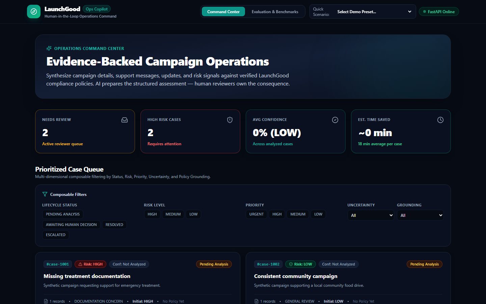
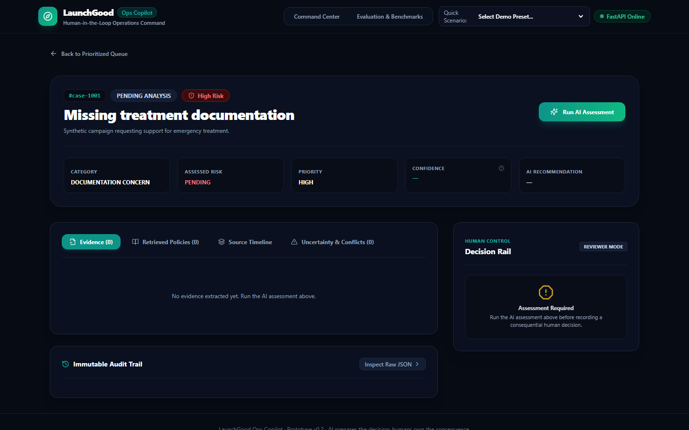
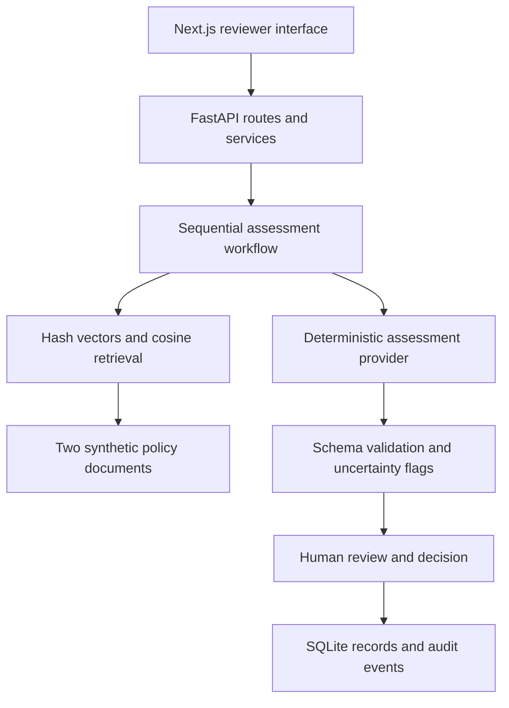
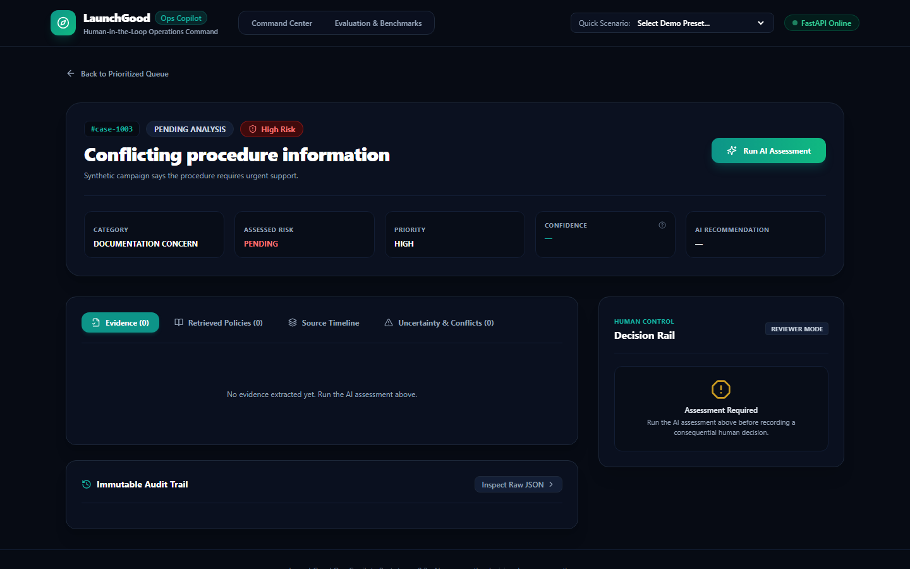
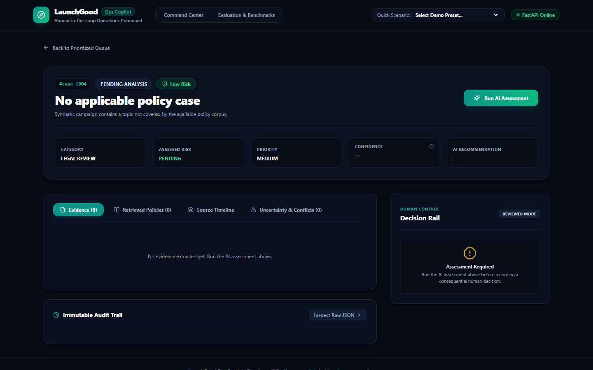
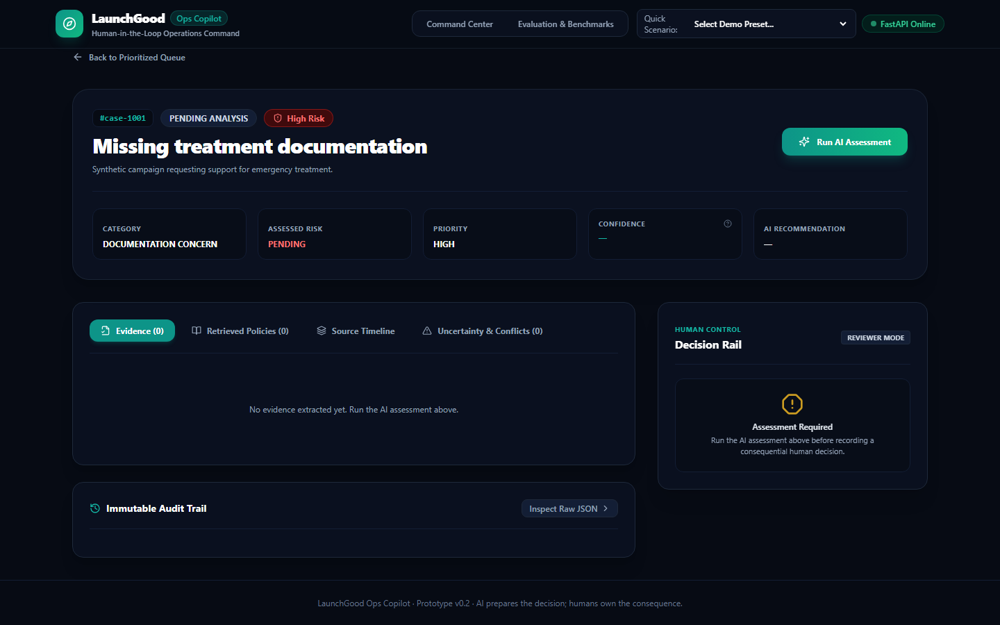
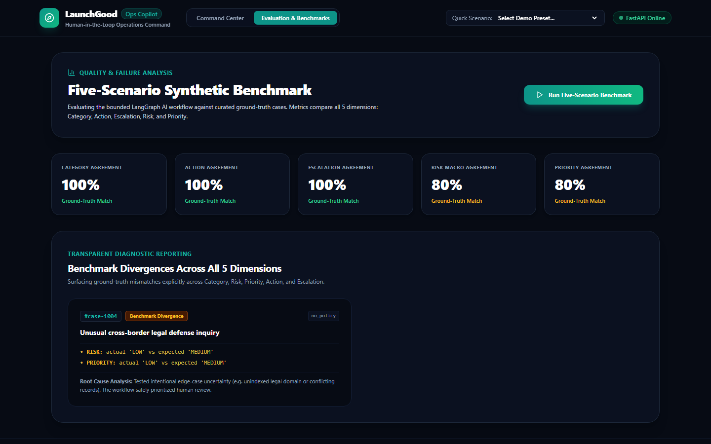
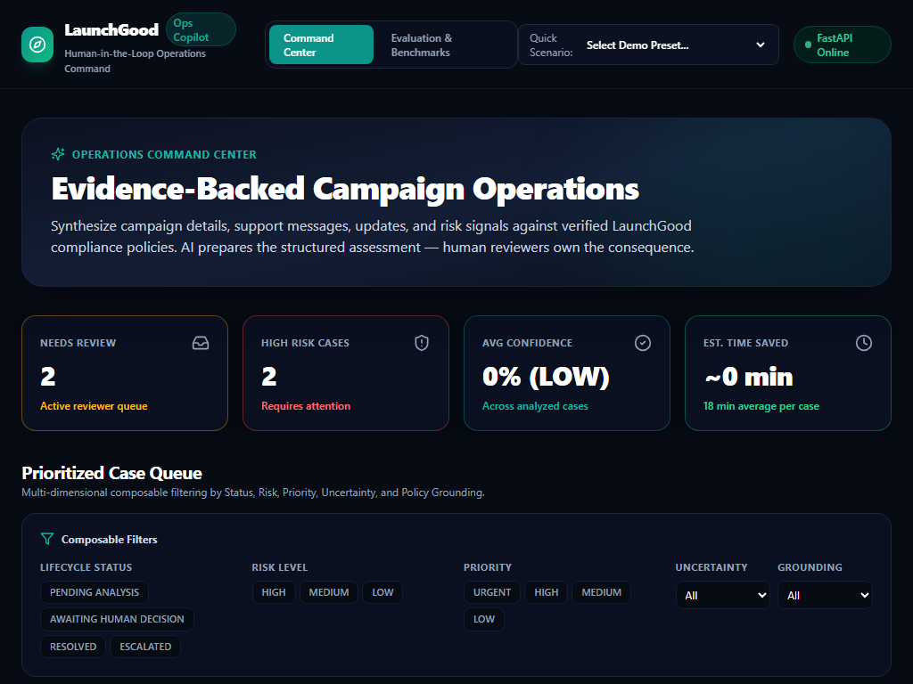
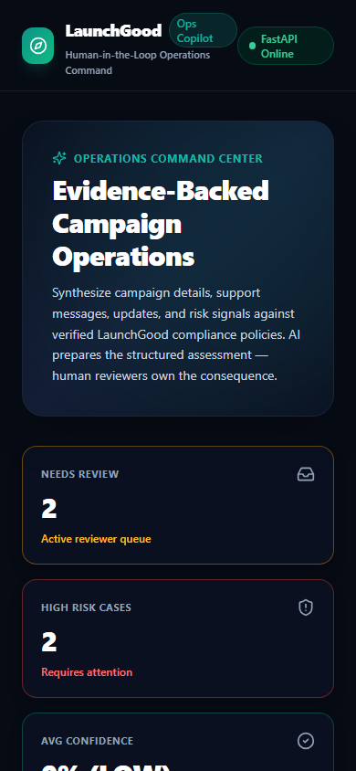

# LaunchGood Ops Copilot

A human-review workflow prototype for **synthetic campaign cases**. It brings campaign context, evidence, local policy references, structured assessments, reviewer decisions, and an audit history into one interface.

> AI prepares the decision; humans own the consequence.

**[Open the demo](https://launchgood-ops-copilot.vercel.app/) · [API documentation](https://launchgood-ops-copilot-m9jo.onrender.com/docs) · [Backend health](https://launchgood-ops-copilot-m9jo.onrender.com/health) · [Engineering docs](docs/README.md)**

The implemented assessment provider is deterministic (`mock`), and retrieval uses local hash-based embeddings over two synthetic policy documents. This demonstrates the review workflow and its boundaries; it does not establish live-LLM quality or real LaunchGood policy verification. The project uses synthetic fixtures rather than real campaign records.



*Existing dashboard capture. Case counts reflect the captured demo state. Confidence is a rule-derived demo score, and estimated time saved assumes 18 minutes per assessed case rather than a measured productivity improvement.*

## Walk through a case

1. **Open a case** from the queue and inspect campaign details, support messages, updates and initial risk signals.
2. **Run an assessment** to normalize the case, retrieve local policy excerpts, extract evidence, identify conflicts and validate a structured recommendation.
3. **Review the result** across Evidence, Retrieved Policies, Source Timeline and Uncertainty & Conflicts.
4. **Record a human decision**: approve, modify, reject or escalate, with optional overrides and reviewer notes. The backend checks the case lifecycle before recording the decision and related audit event.



*Existing case-workspace capture before analysis: the decision rail requires an assessment first. Empty evidence/policy tabs in this image are not proof of a completed assessment.*

## Implemented scope

| Area | Current implementation |
| --- | --- |
| Interface | Next.js 14 / React / Tailwind dashboard, case workspace and evaluation page |
| API and services | FastAPI routes for cases, assessment, decisions, audit history and evaluation |
| Workflow | Explicit sequential Python runner with bounded assessment-validation retries |
| Assessment provider | `FakeLLMProvider`, using normalized synthetic signals and a validated response schema |
| Retrieval | `LocalPolicyIndex` with 256-dimensional token-hash vectors, cosine ranking and grounding thresholds |
| Policy corpus | Two versioned, explicitly synthetic Markdown policies under `data/policies/` |
| Persistence | SQLite-backed cases, assessments, decisions and audit events; evaluation-run lookup is held in memory |
| Demo data | Five synthetic case fixtures, seeded when the API starts and their IDs are absent |



The active runner is [AssessmentWorkflow](app/workflow/runner.py), rather than a compiled LangGraph graph. A FAISS index adapter exists in [app/rag/index.py](app/rag/index.py), but the API constructs the local cosine index. Installing optional `rag` dependencies does not switch that wiring to FAISS or a trained embedding model.

The [provider factory](app/providers/factory.py) accepts `mock`, `fake` and `deterministic` aliases. OpenAI, Anthropic and Gemini are reserved options that raise configuration/implementation errors; adding an API key alone does not enable a live adapter.

## Run locally

Use **Python 3.11+** and **Node.js 20** (the version used by CI).

### Backend

```bash
git clone https://github.com/KhuzaimaHassan/launchgood-ops-copilot.git
cd launchgood-ops-copilot
python -m venv .venv
```

Activate the environment with `.venv\Scripts\Activate.ps1` in PowerShell or `source .venv/bin/activate` in Bash, then run:

```bash
python -m pip install -e ".[api,dev]" httpx python-dotenv
cp .env.example .env
python -m uvicorn app.api.main:app --env-file .env --host 127.0.0.1 --port 8000
```

The explicit `--env-file` loads `.env`; `AppConfig.from_env()` otherwise reads the process environment. `python-dotenv` enables that Uvicorn option, and `httpx` supports the API tests.

The supplied configuration uses `LLM_PROVIDER=mock`, so no external model key is required. SQLite and the local policy corpus are initialized by the application. Open [local health](http://localhost:8000/health) and [local API docs](http://localhost:8000/docs). The health route returns `{"status":"ok"}`; it is not a quality evaluation.

### Frontend

Create `frontend/.env.local` with:

```env
NEXT_PUBLIC_API_URL=http://localhost:8000
```

Set this explicitly for local work: the current frontend default points to the hosted Render backend. In another terminal, from the repository root:

```bash
cd frontend
npm ci
npm run dev
```

Open [http://localhost:3000](http://localhost:3000). The dashboard and case pages use this API URL. An optional Streamlit interface also exists at `app/ui/streamlit_app.py`; the screenshots above show the Next.js interface.

## Connected mode and offline preview

The [frontend API client](frontend/src/lib/api.ts) can substitute bundled cases and assessment/evaluation examples when a network request fails. These fallback assessments are labeled as offline demo results and are not persisted. A visible interface alone therefore does not prove that analysis reached FastAPI.

Decision submission requires a successful backend request. The client reports failure when it cannot record a decision; it does not manufacture a successful offline decision. Backend HTTP errors are generally surfaced instead of being treated as network-fallback results.

The hosted backend may sleep or restart. With the checked-in free-tier Render setup, its local SQLite file is instance-bound and can be reset during restarts/redeploys. Evaluation-run lookup is in memory and is also lost when the process restarts.

## Verification and five-case evaluation

From the repository root, with the backend environment active:

```bash
python -m pytest tests -q
python -m ruff check app tests
```

CI runs the backend tests/lint and a frontend production build. A local source check on **November 10, 2026** passed **37 tests**, including provider selection, retrieval, case lifecycle, decision recording, evaluation and API integration using synthetic data.

The local deterministic evaluation over all five committed case fixtures produced:

| Dimension | Matching cases | Agreement |
| --- | ---: | ---: |
| Category | 5 / 5 | 100% |
| Recommended action | 5 / 5 | 100% |
| Escalation flag | 5 / 5 | 100% |
| Risk | 5 / 5 | 100% |
| Priority | 5 / 5 | 100% |

All five workflows completed without execution errors and matched the unchanged expected labels. The 6 November baseline scored 80% for risk/priority because case-1003 ignored conflicts when no intake risk signal existed; the corrected mock rule now considers detected conflicts. Completion counts and label agreement remain separate measures; `succeeded=5` alone does not establish agreement.

These are exact-match fractions on a small synthetic fixture set, not live-model, real-campaign or independently held-out quality measurements. The benchmark page starts without results until run. Its bundled offline benchmark remains a separately labeled static example and identifies a different mismatch (`case-1004`); it is not execution evidence. New assessments apply documented uncertainty caps; saved historical scores remain unchanged. See [review semantics](docs/product/review-semantics.md) and the [acceptance evidence](docs/testing/acceptance-matrix.md) for scope and browser-verification limits. The [evaluation test](tests/test_evaluation.py), [service](app/services/services.py), and [ground truth](data/evaluation/ground_truth.json) define the actual backend evaluation.

## More interface views

<details>
<summary>Open the existing screenshot gallery</summary>

These captures illustrate interface layouts and captured states. Some case pages were captured before analysis; filenames alone do not establish that a conflict, citation warning or decision submission is visible. The benchmark image is an existing UI capture rather than the fresh local evaluation above.

**Conflicting-information case, before assessment**



**No-policy scenario page**



**Decision rail, with assessment still required**



**Evaluation interface and captured example results**



**Tablet and phone layout captures**





</details>

## Prototype boundaries

- **Human review is a workflow boundary.** Decisions are recorded with a supplied reviewer ID; the API does not implement reviewer authentication or role-based authorization.
- **Audit history is application data.** Events are stored in SQLite; the UI label “Immutable Audit Trail” does not establish cryptographic tamper resistance or durable archival storage.
- **Policy grounding is local and synthetic.** Source IDs and excerpts support inspection, but the prototype does not verify compliance against an authoritative LaunchGood policy service.
- **Assessment scores are deterministic.** Confidence values are demo heuristics rather than calibrated probabilities. The dashboard's time-saved estimate is an assumption.
- **Live providers and LangGraph orchestration remain future work.** Existing docs/UI labels describing those designs should be read alongside the active implementations linked above.

## Engineering references

- [Documentation index](docs/README.md)
- [Product requirements](docs/product/requirements.md) and [decision log](docs/product/decision-log.md)
- [Architecture](docs/architecture/architecture.md) and [workflow design](docs/architecture/ai-workflow.md)
- [Retrieval design](docs/architecture/rag-design.md) and [evaluation notes](docs/ai/evaluation.md)
- [Development setup](docs/development/setup.md) and [deployment guide](docs/deployment/deployment-guide.md)
- [Synthetic dataset](docs/data/synthetic-dataset.md) and [failure cases](docs/testing/failure-cases.md)
